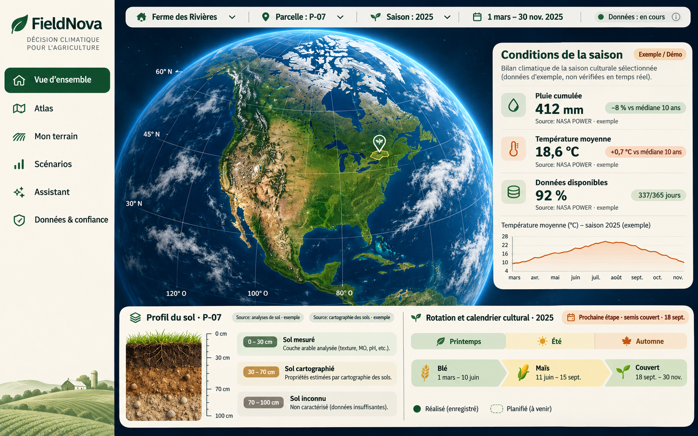
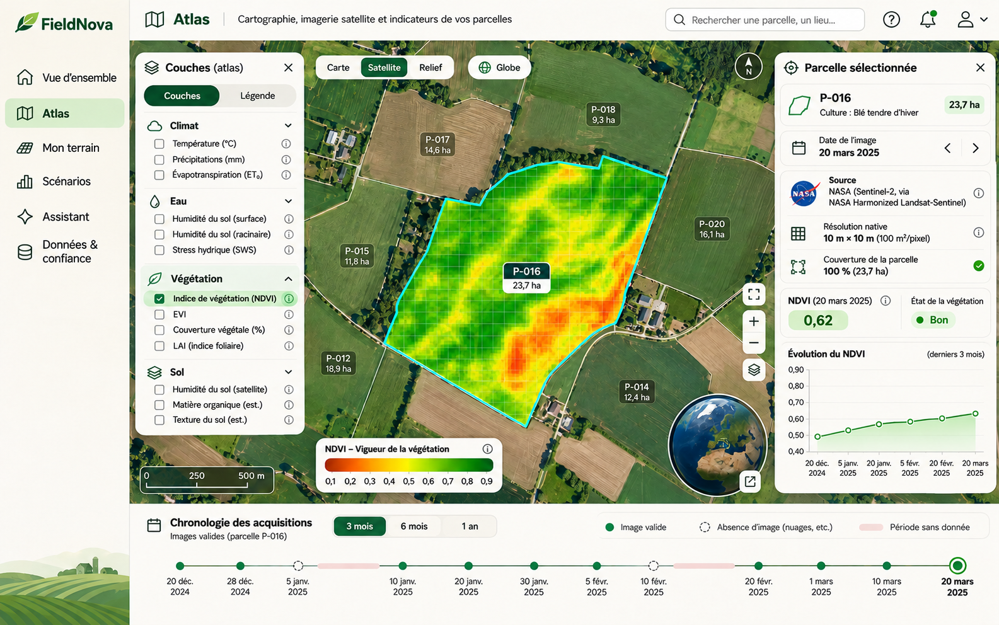
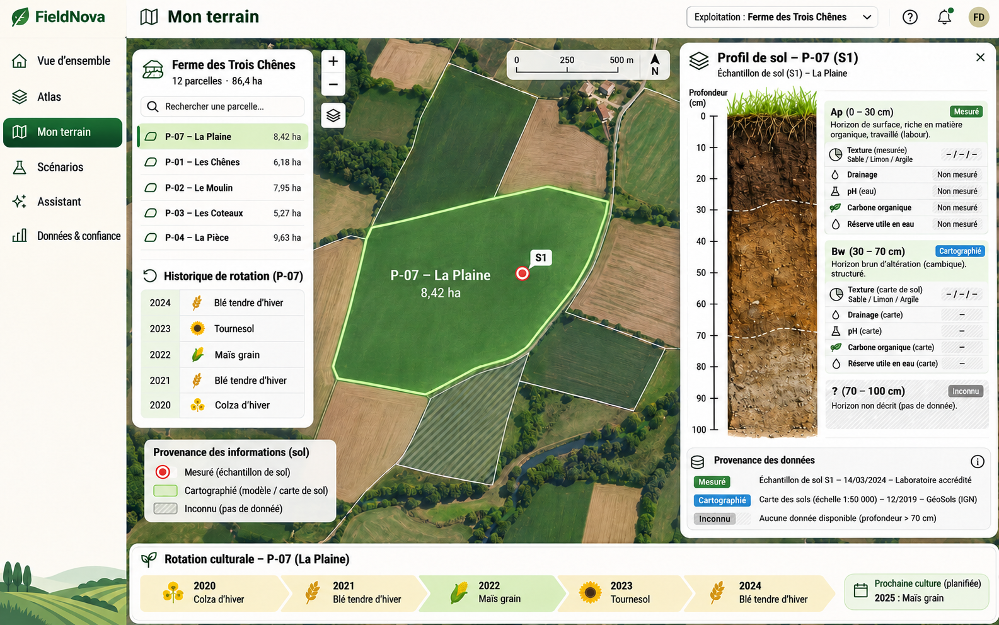
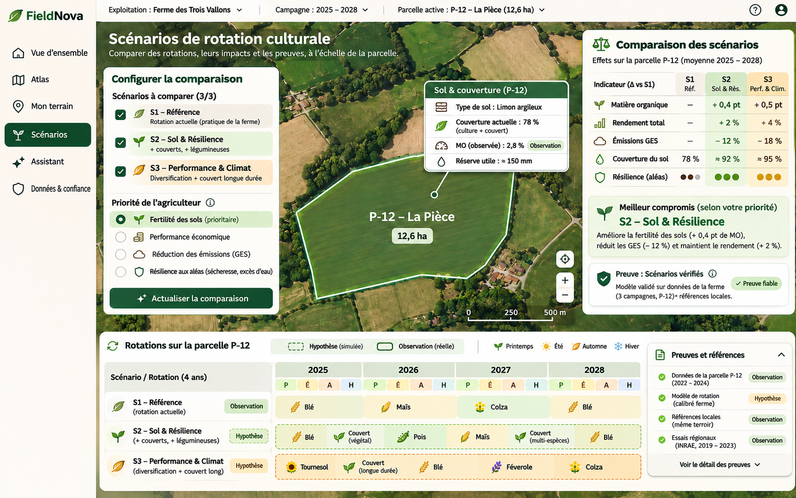
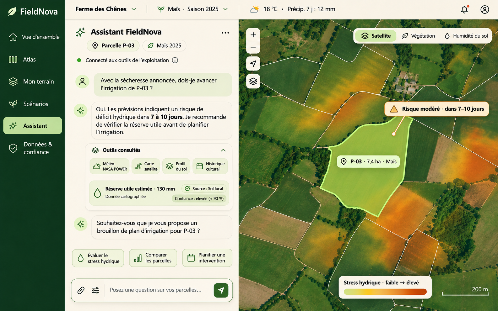
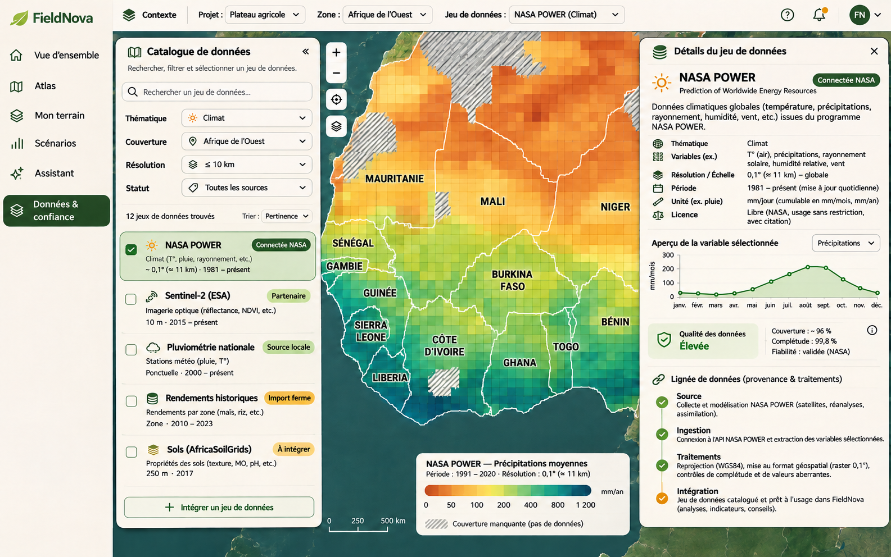

# Concepts UI FieldNova — sélection à valider

Cette sélection rassemble les six écrans générés qui correspondent le mieux aux préférences exprimées : carte interactive au centre, informations en panneaux superposés, navigation latérale cohérente, vues sans défilement vertical, visualisation du sol avec niveaux de confiance et calendrier cultural.

Les images sont des maquettes visuelles. Les nombres, parcelles, emplacements, sources et graphiques affichés sont des exemples de démonstration et ne représentent pas des mesures en temps réel.

## 1. Dashboard — globe, saison, sol et calendrier

Le globe occupe l’espace central. Trois indicateurs de saison restent dans le panneau de droite ; le profil du sol et la rotation culturale partagent le bandeau inférieur. Les profondeurs sont explicitement différenciées entre mesurées, cartographiées et inconnues.

## 2. Atlas — couches et imagerie satellite

Les couches se règlent à gauche, la parcelle et sa carte thermique restent au centre, les détails et la tendance à droite. La chronologie des acquisitions est accessible en bas.

## 3. Mon terrain — parcelles, profil de sol et rotation

La liste des parcelles et l’historique sont à gauche ; la parcelle sélectionnée est mise en évidence sur la carte. Le panneau de droite sépare les mesures, les estimations cartographiques et les données inconnues, avec leur provenance. La rotation reste visible en bas.

## 4. Scénarios — comparaison et preuves

L’agriculteur choisit les scénarios et sa priorité à gauche. La comparaison des résultats et la meilleure option selon cette priorité apparaissent à droite ; les rotations pluriannuelles sont comparées en bas avec une distinction entre observations et hypothèses.

## 5. Assistant — chat à gauche, carte à droite

Le chat de l’assistant est le panneau principal à gauche, avec les questions suggérées, le champ de saisie et une trace des outils agricoles consultés (climat, carte, sol, rotations). La carte interactive occupe la droite. Le routeur local exécute les outils FieldNova; Codex CLI reformule leurs résultats dans la conversation pendant la démo.

## 6. Données & confiance — catalogue, couverture et provenance

Le catalogue et ses filtres sont à gauche ; la couverture géographique est visible au centre ; la fiche de la source, les métadonnées, la qualité et la chaîne de traitement sont à droite.

## À confirmer

Merci de confirmer les écrans que tu souhaites garder, et d’indiquer les ajustements éventuels. Le dashboard du globe est une proposition spécifique pour l’écran d’accueil ; les cinq autres visuels couvrent les onglets de la navigation.

## Démonstration

Le [script de démo de 90 secondes](demo-script-90s-fieldnova.md) suit les fonctions actuellement présentes et rappelle les limites à ne pas masquer pendant la vidéo.
